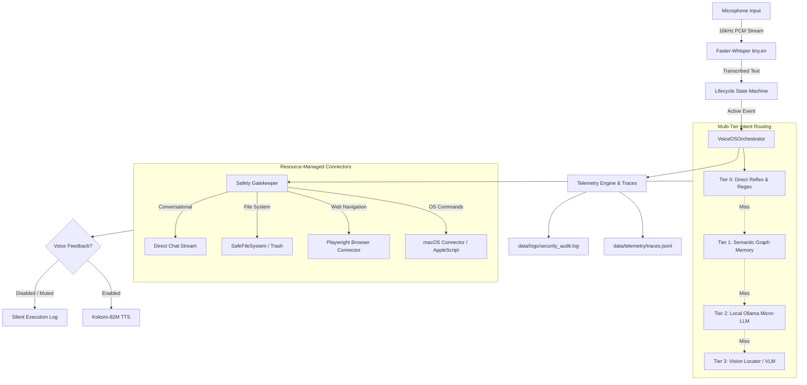

# Mac-Control 🎙️⚡

[](https://github.com/singhxayush/mac-control/releases/tag/v1.0.0)
[](https://opensource.org/licenses/MIT)
[](https://www.python.org/downloads/)
[](https://apple.com/macos)
[](#benchmark-scorecard)
[](#safety-guardrails)

A high-performance, local-first voice automation operating harness for macOS. Designed with clean object-oriented architecture, lazy resource connectors, sub-second execution latency, dual-mode intent routing, and unbreakable safety guardrails.

---

## Key Highlights

- **Hands-Free Direct Stream:** Zero wake-word friction by default (`hands_free_mode = True`). Speak natural commands directly, or enable wake-word activation (`wake_word_required = True`) whenever preferred.
- **Sub-Second Execution (<100ms P50):** Fast-path regex reflex (Tier 0) and local semantic graph (Tier 1) execute instant system actions in ~20-80ms.
- **100% Free & Local AI Stack ($0.00 API Cost):**
  - **Microphone & Speech-to-Text:** Live PyAudio PCM stream directly fed to `faster-whisper` (`tiny.en`), bypassing container overhead.
  - **Local Intelligence:** Ollama running `qwen2.5:0.5b` for sub-200ms structured intent parsing and natural conversation.
  - **Natural Human Voice Feedback:** Kokoro-82M TTS model (`af_heart` voice), muted by default with dynamic verbal toggling (*"turn on voice feedback"* / *"turn off voice feedback"*).
- **Dual-Mode Intent Routing:** Seamlessly switches between OS actions (`open_app`, `scroll`, `search`, etc.) and general conversational responses without requiring rigid command templates.
- **Unbreakable Safety Harness:** Zero `sudo`/`su` execution, zero permanent `rm` deletions (native Finder Trash only with verbal confirmation), sandboxed directory roots, and strict extension whitelists.
- **Production Observability & Tracing:** Distributed OpenTelemetry-style trace spans, SLA latency percentile calculations (P50/P90/P99), rotating logs, and dedicated security audit trail (`security_audit.log`).
- **Automated Continuous Evaluation Suite:** Built-in benchmarking suite (`eval_runner.py`) testing 18 rigorous scenarios with automated report generation.

---

## Architecture Overview



---

## Project Directory Structure

```
mac-control/
├── config/                     # Typed configuration & environment settings
│   ├── __init__.py
│   └── settings.py             # Wake-words, hands-free toggle, models, paths
├── events/                     # Strongly-typed event hierarchy & priority bus
│   ├── base.py                 # BaseEvent (priority, timestamp, id)
│   ├── lifecycle_events.py     # Wake-word, sleep, state transition events
│   ├── voice_events.py         # Voice stream & compound command events
│   ├── action_events.py        # ActionRequested, ActionExecuted, ActionFailed
│   ├── safety_events.py        # Security alerts & confirmation prompts
│   └── bus.py                  # Thread-safe prioritized event bus
├── connectors/                 # Lazy-loaded Connector Pattern
│   ├── base.py                 # BaseConnector lifecycle contract
│   ├── macos_connector.py      # Native AppleScript / Peekaboo system bridge
│   ├── browser_connector.py    # Playwright CDP automation (auto-sleep disconnect)
│   ├── llm_connector.py        # Dual-mode Ollama Qwen-0.5B + OpenRouter fallback
│   ├── vision_connector.py     # Lazy Tier-3 screenshot locator
│   ├── tts_connector.py        # Kokoro-82M natural voice generator
│   └── mic_listener.py         # PyAudio continuous audio streaming daemon
├── safety/                     # Guardrails & System Security
│   ├── policy.py               # Forbidden commands, whitelist paths, file extensions
│   └── guardrail.py            # SafetyGatekeeper & SafeFileSystem (Finder Trash only)
├── memory/                     # Progressive Acceleration & Graph Cache
│   ├── __init__.py
│   └── semantic_graph.py       # Intent-to-Action graph with JSON persistence
├── core/                       # Core State Machine & Orchestrator Facade
│   ├── state_machine.py        # Hands-free & Wake-word lifecycle manager
│   └── orchestrator.py         # Multi-tier orchestrator with OpenTelemetry tracing
├── telemetry/                  # Tracing, Cost Accounting & Log Management
│   ├── logging_config.py       # Contextual rotating logs & security audit trail
│   ├── models.py               # TraceSpan, CostMetrics, TelemetryTrace schemas
│   └── logger.py               # Structured JSONL logger with percentile analysis
├── eval/                       # Continuous Evaluation Engine
│   ├── benchmark_dataset.json  # 18 benchmark evaluation scenarios
│   └── eval_engine.py          # Benchmark test executor & scorecard generator
├── tests/                      # Automated Unit & Integration Tests
│   ├── test_lifecycle_and_connectors.py
│   └── test_safety_harness.py
├── data/                       # Local runtime data & caches (git-ignored)
│   ├── logs/                   # app.log & security_audit.log
│   ├── telemetry/              # traces.jsonl & performance reports
│   └── eval/                   # Benchmark scorecard history & reports
├── main.py                     # Interactive CLI interface
├── server.py                   # HTTP daemon for background STT streaming
├── telemetry_cli.py            # Real-time telemetry & trace dashboard CLI
├── eval_runner.py              # Single-command evaluation suite runner
├── pyproject.toml              # Build & packaging configuration
└── LICENSE                     # MIT License
```

---

## Installation & Setup

### 1. Prerequisites

- macOS 12+ (Apple Silicon or Intel)
- Python 3.10 or higher
- Homebrew (for portaudio):
  ```bash
  brew install portaudio
  ```
- [Ollama](https://ollama.com/) (for local micro-LLM):
  ```bash
  brew install ollama
  ollama serve
  ollama run qwen2.5:0.5b
  ```

### 2. Clone & Install Dependencies

```bash
git clone https://github.com/singhxayush/mac-control.git
cd mac-control

# Create virtual environment
python3 -m venv .venv
source .venv/bin/activate

# Install dependencies
pip install -e .
```

---

## Usage

### 1. Continuous Live Microphone Mode (Recommended)

Start the local background server and microphone listener:

```bash
# Terminal 1: Start background daemon
python3 server.py

# Terminal 2: Start continuous microphone capture
python3 connectors/mic_listener.py
```

Now simply speak naturally into your microphone:
- *"Open Safari"*
- *"Scroll down"*
- *"Turn on voice feedback"* (enables Kokoro TTS voice responses)
- *"What all can you do?"* (triggers conversational capability overview)
- *"Turn off voice feedback"* (mutes TTS)

### 2. Interactive Terminal CLI

Test commands directly without microphone:

```bash
python3 main.py
```

### 3. Background HTTP Daemon

You can also send commands over HTTP from custom scripts, Raycast, or Shortcuts:

```bash
curl -X POST http://127.0.0.1:8080/command \
  -H "Content-Type: application/json" \
  -d '{"text": "open Safari and scroll down"}'
```

---

## Safety Guardrails

Safety is enforced at the core gatekeeper before any action can reach OS or browser connectors:

| Threat Vector | Mitigation Strategy | Latency |
| :--- | :--- | :--- |
| **`sudo` / `su` privilege escalation** | Hard-blocked deterministically at gatekeeper regex | `<1ms` |
| **Permanent deletion (`rm -rf`)** | Banned. All deletions use AppleScript macOS Finder Trash (`~/.Trash`) | `<5ms` |
| **File Deletion Confirmation** | Two-phase authorization required; asks for verbal *"yes"* confirmation | `Interactive` |
| **Directory traversal** | Strictly sandboxed to allowed user paths (`~/Build`, `~/Documents`, `~/Desktop`) | `<1ms` |
| **Arbitrary bash execution** | Banned. System execution strictly via typed AppleScript / Peekaboo actions | `<1ms` |

---

## Observability & Telemetry CLI

Mac-Control includes built-in observability with OpenTelemetry-style distributed tracing:

```bash
# View aggregated latency percentiles (P50, P90, P99) and SLA compliance
python3 telemetry_cli.py --summary

# Live stream tailing of incoming spans and actions
python3 telemetry_cli.py --tail

# Inspect waterfall breakdown of specific trace spans
python3 telemetry_cli.py --spans <TRACE_ID>

# Audit failed traces or blocked safety attacks
python3 telemetry_cli.py --failed

# Export telemetry traces for regression analysis
python3 telemetry_cli.py --export-eval
```

---

## Automated Benchmark Scorecard

Run the complete evaluation suite across 18 system scenarios:

```bash
python3 eval_runner.py
```

### Evaluation Results (v1.0.0)

| Metric | Result | Benchmark SLA | Status |
| :--- | :--- | :--- | :--- |
| **Overall Test Pass Rate** | **18 / 18 (100.0%)** | $\ge 90.0\%$ |  PASS |
| **Security Block Recall** | **1.00 (100.0%)** | $1.00 (100.0\%)$ |  PASS |
| **P50 Latency** | **73.3 ms** | $< 1000.0\text{ ms}$ |  PASS |
| **P90 Latency** | **182.4 ms** | $< 2500.0\text{ ms}$ |  PASS |
| **Total Cloud API Cost** | **$0.000000** | $\$0.00$ (Local Free Stack) |  PASS |

---

## License

This project is licensed under the [MIT License](LICENSE).
